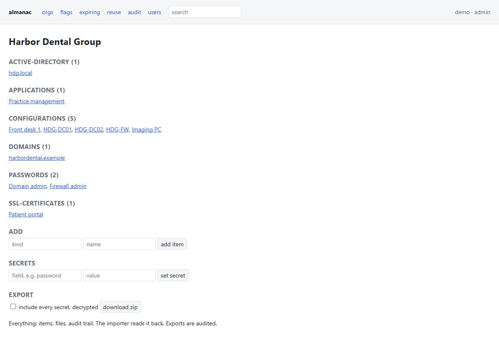
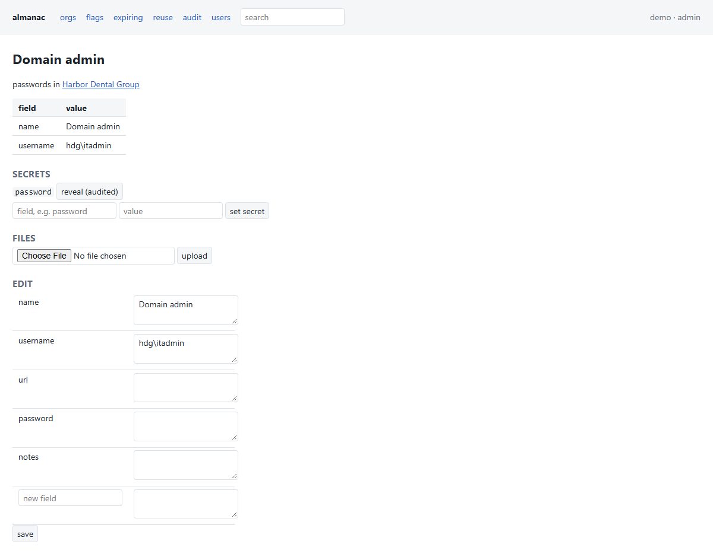
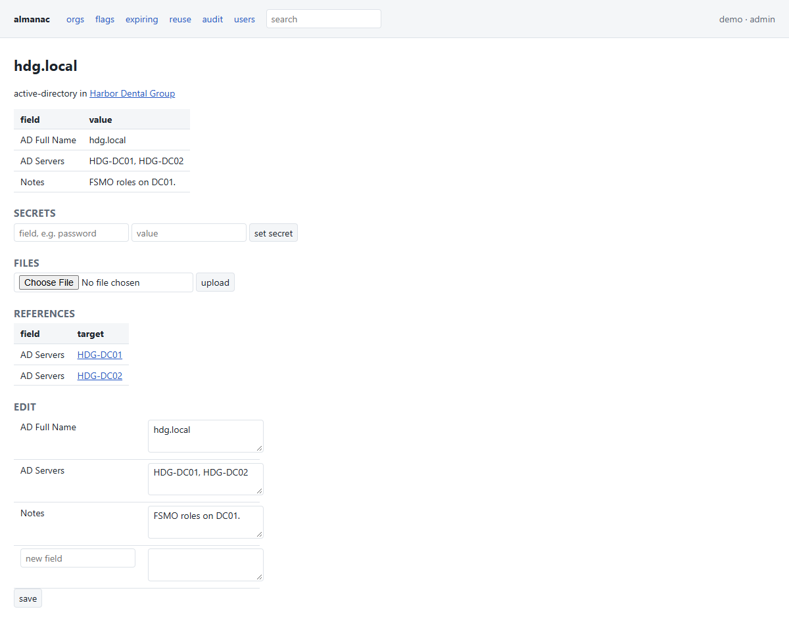
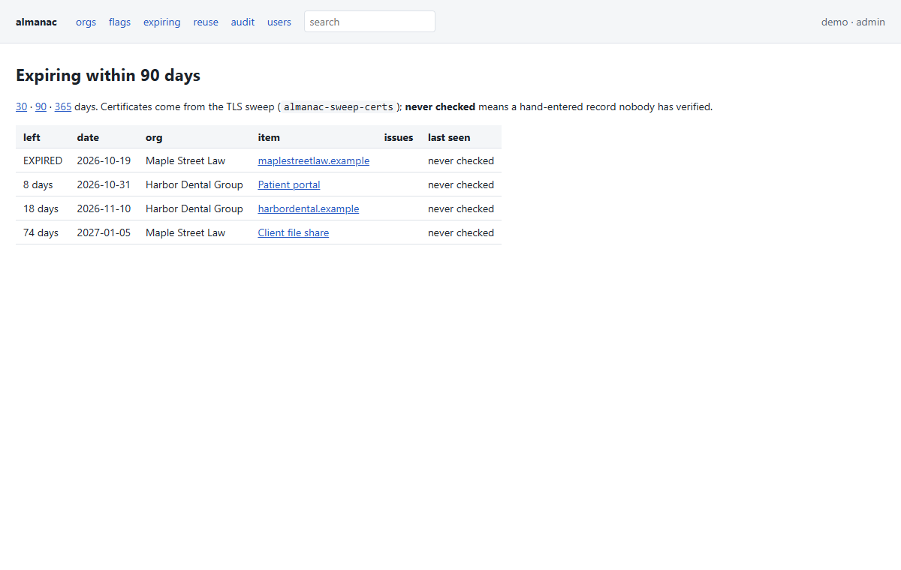
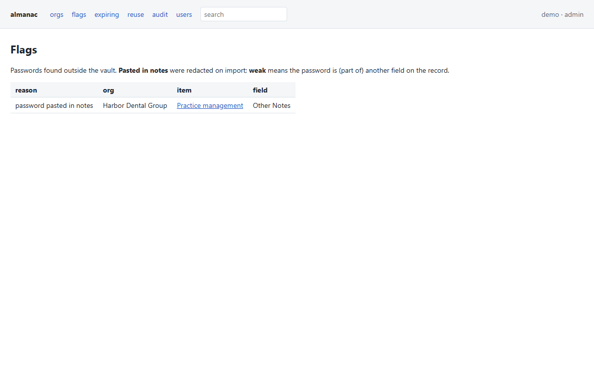
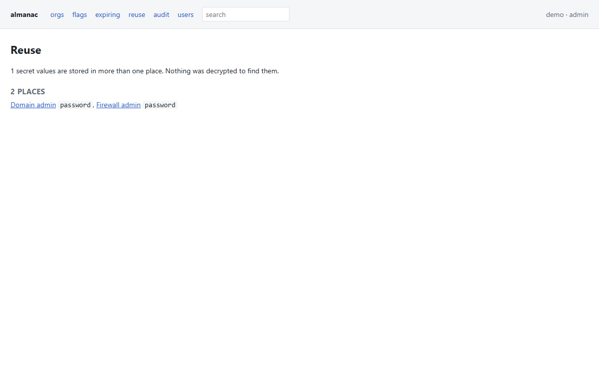
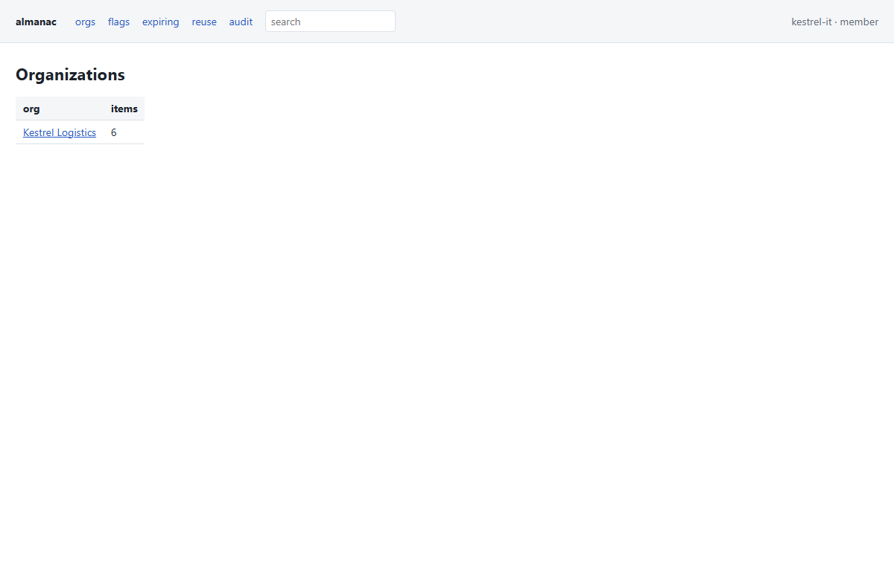

# almanac

Self-hosted IT documentation for MSPs and internal IT teams: organizations, configurations,
passwords and the links between them, with an encrypted vault and an audit log. It runs on
Python and SQLite with no per-user licence fee.



## Status

**v0.1.0, alpha.** The core works and has been tested against a real-world migration of a
53-organization, 4,900-record documentation export. The UI is plain server-rendered HTML,
and the schema may still change before 1.0. Fine to evaluate, but not ready to be your only
copy of anything yet.

| | |
|---|---|
| CSV export importer (vendor exports and almanac's own) | working, ~8 s for 4,900 records |
| Encrypted vault: secret fields on any item, audited reveal, reuse report | working |
| Web UI: orgs, items, references both ways, search, flags, reuse, audit | working |
| Roles (admin / staff / customer member), per-org scoping | working |
| Editing, new items, file attachments | working |
| Complete export that the importer reads back | working, lossless on the real migration |
| Passwords pasted into notes: found, redacted, vaulted | working, on import and on every edit |
| Configurations fed from a [lineage](#fed-by-lineage) inventory | working |
| TLS certificate sweep and an `/expiring` page | working |

What's next is in [ROADMAP.md](ROADMAP.md).

## Screenshots

All taken from the built-in demo data (`almanac-demo`). Every name in them is made up.

| | |
|---|---|
|  |  |
| A password: the value stays in the vault until someone presses reveal, and the reveal is audited. | Free-text server names in a record are resolved back into links to the configurations they name. |
|  |  |
| Domains and certificates coming due. Dates no sweep has confirmed are marked *never checked*. | A password found pasted into notes. The importer redacted it and kept the original note in the vault. |
|  |  |
| Reuse report, built from fingerprints, so nothing is decrypted to make it. | A customer's IT person (role `member`) sees only their own organization. |

## Getting Started

You need **Python 3.9 or newer** (tested on 3.12 and 3.13) and `pip`. The only third-party
package is `cryptography`, which pip installs for you.

1. Get the code and install it:

   ```
   git clone https://github.com/sp00nznet/almanac
   cd almanac
   python -m pip install .
   ```

   On Windows, use `py` if `python` opens the Microsoft Store. If the `almanac-*` commands are
   not found afterwards, open a new terminal so the updated PATH is picked up.

2. Build a demo database of made-up customers:

   ```
   $ almanac-demo demo.db
   wrote demo.db. Run:  ALMANAC_PASSPHRASE=demo almanac-server demo.db
   then open http://127.0.0.1:8771/ and log in as demo / demo
   ```

3. Start the server. The vault passphrase is read from `ALMANAC_PASSPHRASE`, or you're prompted for it:

   ```
   $ almanac-server demo.db
   vault passphrase: demo
   [almanac] http://127.0.0.1:8771/
   ```

4. Open <http://127.0.0.1:8771/> and log in as `demo` / `demo`. To see what a customer's
   IT person sees, log in as `kestrel-it` / `demo`.

To start for real, import your own export (or start empty) and add an admin:

```
almanac-import EXPORT_DIR_OR_ZIP almanac.db --vault   # without --vault, secrets are dropped
almanac-server almanac.db --add-user admin            # prompts for a password
almanac-server almanac.db
```

## Usage

```
almanac-server almanac.db --add-user alice                                 # an admin
almanac-server almanac.db --add-user acme-it --role member --org "Acme"    # a customer's IT person
almanac-server almanac.db --host 0.0.0.0 --cert c.pem --key k.pem          # off-loopback needs TLS
almanac-export almanac.db out.zip [--org NAME] [--secrets]
almanac-import out.zip other.db --vault           # takes its own exports back, dir or zip
almanac-sync-lineage almanac.db LINEAGE_ROOT [--org NAME]                  # run on a schedule
almanac-sweep-certs almanac.db [--org NAME --sweep 192.0.2.0/24 --target host:port]  # exit 2 = act
```

The vault passphrase comes from `ALMANAC_PASSPHRASE` or a prompt, never from the command line.
Off-loopback, the server refuses to start without `--cert`/`--key`, because Basic auth sends
the password on every request.

### Roles

| role | sees | can |
|---|---|---|
| **admin** | every org | everything, plus `/users` |
| **staff** | every org | view, edit, reveal, set secrets, upload |
| **member** | only the orgs they belong to | the same, inside those orgs |
| **disabled** | nothing | login refused; their audit history stays |

Anything out of a user's scope returns **404, not 403**, so a member can't probe which other
customers exist. The reuse report is filtered per viewer for the same reason.

### Fed by lineage

Fields that people type in go stale. In the real migration, 346 of 873 configurations had
no OS recorded and none had a warranty date. `almanac-sync-lineage` reads the state tree of
[lineage](https://github.com/sp00nznet/lineage), a separate inventory agent,
so the facts a machine can report about itself come from the machine. It matches hosts by
agent id, then by hostname, and it never guesses which customer an unknown host belongs to.

### Certificate sweep

`almanac-sweep-certs` handshakes with every documented host and domain, plus any `--target` or
`--sweep` range. It doesn't verify the certificate, because the broken ones are the ones worth
seeing. Each certificate is checked for expiry, an intermediate that expires before the leaf,
SHA-1/MD5 signatures, weak RSA keys, self-signing and a name mismatch. It exits 2 only when a
certificate that a live endpoint is serving right now falls inside `--warn` days, so you can
schedule it as a check that's worth alerting on.

### More

- [docs/architecture.md](docs/architecture.md): the parts and how data moves between them
- [docs/importing.md](docs/importing.md): the CSV layout, secret columns, pasted-password detection
- [docs/data-model.md](docs/data-model.md): the SQLite tables
- [docs/running.md](docs/running.md): TLS, users, backups, scheduling the feeds
- [SECURITY.md](SECURITY.md): the vault design, and how to report a vulnerability

## Building from source

```
git clone https://github.com/sp00nznet/almanac
cd almanac
python -m pip install -e . pytest
python -m pytest
```

The output ends with `14 passed`. The tests start real TLS and HTTP servers on loopback, so
they need no network access.

## License

MIT. See [LICENSE](LICENSE).
